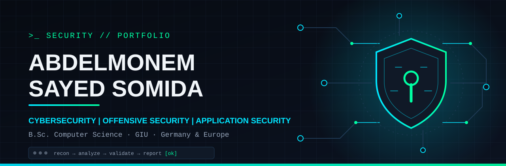

### Cybersecurity Student &nbsp;·&nbsp; Offensive Security &nbsp;·&nbsp; Application Security &nbsp;·&nbsp; Security Engineering

B.Sc. Computer Science (Cybersecurity) at the German International University · Seeking internships and entry-level roles in Germany and Europe

**[About](#about) · [Focus](#cybersecurity-focus) · [Projects](#featured-security-projects) · [Experience](#professional-experience) · [Research](#research) · [Arsenal](#technical-arsenal) · [Competitions](#competitions) · [Contact](#education-and-contact)**

---

## About

I am a Computer Science student specializing in Cybersecurity at the German International University (GIU), currently in Ulm, Germany for my Bachelor's thesis research.

My hands-on experience spans a **cybersecurity internship at Breadfast** (web reconnaissance, WordPress assessment, controlled vulnerability testing), **authorized offensive security labs** (web, Linux, Windows and Active Directory), **application security assessments**, **digital forensics**, and **network security design**. My thesis investigates **secure Multi-Party Computation (MPC) for privacy-preserving AI training**.

I like understanding how systems fail, from input validation and access control to network trust boundaries, and documenting findings so others can act on them.

> **Responsible practice.** Security testing in this portfolio was performed in authorized or intentionally vulnerable lab environments, simulated networks, internship scope, or coursework. Labs and coursework are labelled as such; none of it is presented as a professional penetration-testing engagement.

---

## Cybersecurity Focus

**Offensive Security** — Authorized lab work on enumeration, exploitation validation, privilege escalation and Active Directory attack chains.
`Nmap` `Metasploit` `Impacket` `Kerbrute` `Evil-WinRM`

**Application & Web Security** — Reconnaissance, content discovery and controlled testing for injection, XSS, CSRF, SSRF and access-control flaws.
`Burp Suite` `OWASP Top 10` `WPScan` `ffuf` `httpx`

**Digital Forensics & Incident Investigation** — Memory, registry and PCAP analysis; extraction of indicators of compromise.
`Volatility 3` `FTK Imager` `Wireshark` `NetworkMiner`

**Network & Infrastructure Security** — Segmentation, device hardening, centralized authentication and logging in simulated networks.
`Cisco IOS` `OSPF` `ACLs` `TACACS+` `IPsec`

**Security Research & Privacy-Preserving AI** — Bachelor thesis on secure MPC for neural-network training.
`MP-SPDZ` `Secure MPC` `Python`

---

## Featured Security Projects

Each project links to its repository, where the write-ups and reports live. Scope is stated honestly for every one.

### 1 · [Offensive Security Labs](https://github.com/Mon3em20/offensive-security-labs)
> **Authorized educational lab work, not professional engagements.** Seven documented write-ups on TryHackMe and intentionally vulnerable machines: passive web reconnaissance, directory enumeration, MS17-010 validation, Apache Tomcat WAR deployment, Linux privilege escalation, cron/PATH hijacking, and an Active Directory chain (Kerberos enumeration, AS-REP roasting, DCSync, NTDS extraction, Pass-the-Hash).
>
> **Tools:** `Nmap` `Burp Suite` `Metasploit` `MSFVenom` `Impacket` `Kerbrute` `Evil-WinRM` `John the Ripper`
> **Demonstrates:** structured attack methodology and clear technical reporting. Most labs include a PDF report.

### 2 · [OWASP Juice Shop Security Testing](https://github.com/Mon3em20/owasp-juice-shop-security-testing)
> **Controlled application security assessment** of an intentionally vulnerable app. Covers stored, DOM-based and reflected XSS, UNION-based SQL injection, SQL-injection authentication bypass, CSRF, SSRF, broken CORS, brute-force login, weak password recovery and missing authorization controls. Two PDF assessment reports.
>
> **Tools:** `Burp Suite` `Burp Intruder` `Browser DevTools` `Kali Linux`
> **Demonstrates:** manual vulnerability validation and remediation-oriented reporting.

### 3 · [Digital Forensics Investigations](https://github.com/Mon3em20/digital-forensics-investigations)
> **DFIR and investigative analysis** in lab environments. Windows memory forensics (processes, user sessions, registry artifacts) and network forensics on malicious PCAP traffic (suspicious domains, exposed FTP credentials, indicators of compromise). Two PDF reports.
>
> **Tools:** `Volatility 3` `FTK Imager` `Wireshark` `NetworkMiner`
> **Demonstrates:** evidence-driven analysis and investigation reporting.

### 4 · [Enterprise Network Security](https://github.com/Mon3em20/enterprise-network-security-lab)
> **Academic simulated network (Cisco Packet Tracer), team coursework, not a production deployment.** Multi-branch design with OSPF Area 0, VLANs, DMZ segmentation, TACACS+ AAA, SSH v2 hardening, port security, extended ACLs, IPsec VPN, centralized SYSLOG and verification of the configuration. Two PDF reports.
>
> **Tools:** `Cisco IOS` `Packet Tracer` `OSPF` `TACACS+` `IPsec`
> **Demonstrates:** layered, defense-in-depth network design.

### 5 · [Secure MPC Bachelor Thesis](https://github.com/Mon3em20/graduation-mpc-ff)
> **Ongoing research.** Plaintext Backpropagation and Forward-Forward baselines on MNIST, plus a bounded three-party Secure Backpropagation prototype in MP-SPDZ. See [Research](#research) for exactly what is complete and what is future work.
>
> **Tools:** `Python` `MP-SPDZ` `Secure MPC`
> **Demonstrates:** reproducible, evidence-tracked experimental method.

### 6 · [IAM Risk Assessment & Business Continuity](https://github.com/Mon3em20/iam-business-continuity-planning)
> **Academic design and documentation project; not deployed.** NIST SP 800-30 risk assessment, risk register, business impact analysis, RTO/RPO, Active Directory architecture, backup strategy, disaster recovery and high-availability planning.
>
> **Tools:** `NIST SP 800-30` `Active Directory` `BCP/DR`
> **Demonstrates:** GRC thinking and security resilience planning.

---

## Professional Experience

### Cybersecurity Intern · Breadfast
July 2026 – August 2026 · **Professional internship**

- Web reconnaissance and technology fingerprinting: subdomain and endpoint discovery and WordPress assessment.
- Automated content discovery and organized results into structured CSV and JSON reports.
- Controlled testing for SQL injection, XSS, OS command injection and path traversal.
- **Tools:** `httpx` `WhatWeb` `WPScan` `ffuf` `feroxbuster` `dirsearch` `Python` `Burp Suite`

### Software Development Intern · Genesis Infotech (Arma Group)
July 2025 – September 2025 · **Professional internship**

- Full-stack features with Node.js and React on MongoDB and Supabase, including JWT authentication, role-based access control and API input validation.
- Built a Python Course Management System as part of a team.

---

## Research

### Biologically Plausible Secure Multi-Party Computation (MPC) for Efficient Privacy-Preserving AI Training
**Bachelor thesis · ongoing** · GIU · research stay in Ulm, Germany

**Question.** How do Backpropagation (BP) and the biologically inspired Forward-Forward (FF) algorithm compare in utility, computation and communication when training must stay private?

**Method.** Plaintext BP and FF baselines on MNIST (five random seeds), then secure computation with [MP-SPDZ](https://github.com/data61/MP-SPDZ) v0.4.4 in a three-party, semi-honest, honest-majority Rep3 Ring setting.

| Status | Work |
|---|---|
| ✅ Complete | Stage A: environment and plaintext feasibility, plaintext BP and FF baselines |
| ✅ Complete | Stage B: bounded Secure BP prototype, executed on a small MNIST subset (90 / 30 / 30 examples) |
| ⏳ Future | Stage C: Secure Forward-Forward · Stage D: per-operation BP/FF profiling · Stage E: MPC-aware FF modification |

The bounded prototype is a feasibility result, **not** full-MNIST or production-scale secure training. Secure Forward-Forward and Spiking Neural Networks have **not** been implemented.

[Open the research repository →](https://github.com/Mon3em20/graduation-mpc-ff)

---

## Technical Arsenal

| Area | Tools and concepts |
|---|---|
| **Application & Web Security** | `Burp Suite` `OWASP Top 10` `Nmap` `WPScan` `httpx` `WhatWeb` `ffuf` `feroxbuster` `dirsearch` |
| **Offensive Security Labs** | `Kali Linux` `Metasploit` `Impacket` `Kerbrute` `Evil-WinRM` `Active Directory attack paths` `Linux privilege escalation` |
| **Digital Forensics** | `Volatility 3` `FTK Imager` `Wireshark` `NetworkMiner` |
| **Network Security** | `Cisco IOS` `Packet Tracer` `OSPF` `ACLs` `TACACS+` `IPsec VPN` `SSH hardening` `SYSLOG` |
| **Programming** | `Python` `JavaScript/TypeScript` `Java` `C++` `SQL` |
| **Software & Cloud** | `Node.js` `React` `MongoDB` `Supabase` `REST APIs` `JWT` `RBAC` `AWS Cognito` `Lambda` `DynamoDB` |
| **Security Research** | `MP-SPDZ` `Secure MPC` `Privacy-preserving AI` |
| **Risk & Governance** | `NIST SP 800-30` `IAM` `BIA` `BCP/DR` |

---

## Competitions

**GIU Capture The Flag 2026** (12 May 2026) — team participation as "Flag ela rob3" across Digital Forensics, Web Security, Cryptography and OSINT. **Team score: 1,500 points** (a team result, not an individual score).
[Repository and details](https://github.com/Mon3em20/CTF-2026-GIU)

---

## Other Technical Projects

<strong>Other Technical Projects &amp; Coursework</strong> (click to expand)

 

- [**Emotion Classification**](https://github.com/Mon3em20/emotion-classification-distilbert-bilstm): text emotion classification comparing Bi-LSTM and DistilBERT.
- [**Deep Learning Image Captioning**](https://github.com/Mon3em20/deep-learning-image-captioning): ResNet50 feature extraction with an LSTM caption generator on MS COCO.
- [**DES in CBC Mode**](https://github.com/Mon3em20/DES-Encryption-in-CBC-Mode): from-scratch Python DES with CBC chaining. *Educational only; DES is obsolete and not suitable for modern production use.*
- [**RSA Implementation**](https://github.com/Mon3em20/RSA-Encryption-and-Decryption-Implementation): Java BigInteger RSA key generation, encryption and decryption. *Educational textbook RSA without padding; not for production use.*
- [**TCP Chat Application**](https://github.com/Mon3em20/Bi-Directional-Chat-Application-with-TCP-Analysis): Java socket client and server.
- [**Smart Attendance Tracking, Agile Planning**](https://github.com/Mon3em20/smart-attendance-tracking-agile-project): Scrum documentation for a QR/BLE attendance app (team course project).

---

## Education and Contact

**B.Sc. Computer Science, German International University (GIU), Egypt** · 2023–2027 · Specialization: Cybersecurity
**Languages:** Arabic (native) · English (B2) · German (B1)
**Location:** currently in Ulm, Germany for thesis research (temporary)

I am interested in cybersecurity internships and entry-level opportunities in offensive security, penetration testing, application security, network security, digital forensics and security engineering across Germany and Europe.

[LinkedIn](https://www.linkedin.com/in/abdelmonem-sayed-somida-9739b2312) · [GitHub](https://github.com/Mon3em20) · [TryHackMe](https://tryhackme.com/p/monemsomida) · [monemsomida@gmail.com](mailto:monemsomida@gmail.com)

